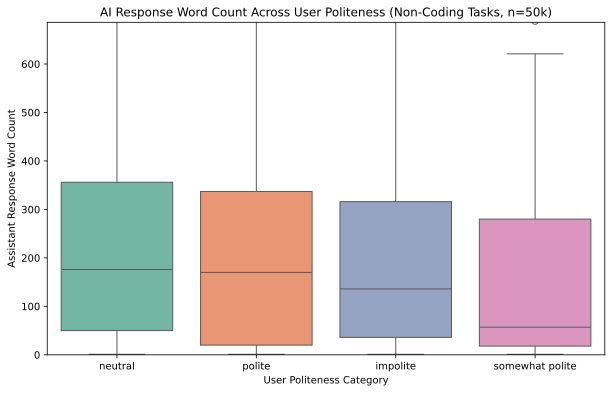

# Quantifying the Politeness Premium: Evaluating User Tone and LLM Response Length Bias

## 📌 Executive Summary

This quantitative UXR case study analyzes **50,000+ real-world user-assistant** conversations from the WildChat-4.8M dataset to evaluate whether user tone (politeness, neutrality, or impoliteness) introduces a structural response-length bias in commercial large language models (LLMs).

While raw medians initially suggest a large gap, rigorous non-parametric testing reveals that the popular assumption of a linear "politeness premium" is nuanced: being overly polite does not unlock extra tokens, but dropping below neutral into abrasive or impolite tones incurs a significant **29.4% reduction in response length**.

## 🎯 Key Findings

* **The Myth of the Politeness Premium:** Polite responses yield a negligible -3.4% median length difference compared to neutral ones (Not Significant via post-hoc testing, $p > 0.05$); commercial models treat standard neutral text as the default baseline.
* **The Impoliteness Tax (Ouch!):** Neutral responses are 29.4% longer than impolite ones, a statistically significant drop ($p < 0.05$) confirming that abrasive or blunt user prompts trigger safety and alignment length compression.
* **Confounder Control & Hygiene:** Restricting corpora via native language metadata and stripping out dense code-block interactions via custom regex are critical for isolating true conversational behavioral shifts.

## 💡 Strategic Product Recommendations

**1. Do Not Over-Engineer Polite System Prompts:** Do not waste engineering cycles expecting polite user framing to inherently unlock deep, exhaustive model essays; standard neutral inputs are treated as the conversational default.

**2. Account for Guardrail Compression on Blunt Inputs:** Recognize that safety and alignment layers react to abrasive or impolite user inputs by clamping down on output depth, which can unintentionally degrade conversational UX for frustrated users.

**3. Enforce Strict Multi-Shard Data Sampling:** Avoid single-shard sampling bias in large-scale log analysis by distributing extractions across randomized dataset shards to capture true population variance.

## 🛠️ Tech Stack & Methodology

* **Data Processing:** Pandas, Datasets (High-throughput parquet ingestion and multi-shard sampling of WildChat-4.8M)

* **NLP & Classification:** Intel/polite-guard (Batch transformer classification for user tone categorization)

* **Statistical Framework:** SciPy & scikit-posthocs (Kruskal-Wallis H-test for global variance and Dunn's post-hoc test with Bonferroni correction)

* **Visualization:** Seaborn / Matplotlib (Vector-ready SVG boxplots and significance heatmaps)
